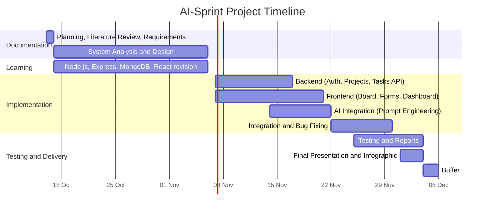

# AI-Sprint – Agile Project Management & Task Automator

**DEPI Graduation Project | Submission 1: Planning, Literature Review, Requirements**
**Date:** 16 October 2026
**Repository:** https://github.com/ahmed-abdallah-23/AI-Sprint

---

# Part 1: Project Planning & Management

## 1.1 Project Proposal

### Overview
AI-Sprint is a web application for development teams. The user enters a high-level **Project Goal**, and the system uses AI to turn it into **user stories**, **acceptance criteria**, and **technical tasks**. The tasks are then managed on a team board (To Do / In Progress / Done) with Admin and Member roles.

### Problem Statement
Teams starting a new project spend a lot of time deciding where to begin, splitting the work, and defining what "done" means for each task. This is slow, and unclear tasks cause misunderstandings and delays.

### Objectives
1. Automatically generate user stories, acceptance criteria, and tasks from a project goal using AI.
2. Give teams a simple board to track task progress.
3. Support teams with two roles: Admin (creates projects, manages the team, assigns tasks) and Member (works on assigned tasks).
4. Provide a dashboard showing project progress.
5. Apply full-stack development skills: React, Node.js, Express, MongoDB, REST API, and prompt engineering.

### Scope

**In scope (core):**
- User registration and login
- Create a project and enter a project goal
- AI generation of user stories, acceptance criteria, and tasks
- Task board (To Do / In Progress / Done)
- Team management (Admin adds members) and manual task assignment
- Progress dashboard

**Planned enhancements (only if time allows):**
- Automatic task assignment by AI based on member skills
- TypeScript and Redux Toolkit
- Docker / Docker Compose
- Real-time updates across team members

**Out of scope:**
- Mobile application
- Payment or subscription features
- Integrations with external tools (Jira, Slack, etc.)

### Target Users
Student teams and small development teams who need to organize work on a software project.

### Technology Stack

| Layer | Technology |
|---|---|
| Frontend | React, Bootstrap (Modals, Navbar, responsive grid) |
| Backend | Node.js, Express (RESTful API) |
| Database | MongoDB |
| AI | AI API with prompt engineering |
| Version Control | Git and GitHub |

---

## 1.2 Project Plan

**Project duration:** 16 Oct 2026 – 6 Dec 2026 (discussion). Implementation is due 30 Nov 2026, leaving the last week as a buffer.

### Milestones and Deliverables

| # | Milestone | Deadline | Deliverables |
|---|---|---|---|
| M1 | Planning, Literature Review, Requirements | 16 Oct 2026 | This document |
| M2 | System Analysis & Design | 6 Nov 2026 | Use case diagram, ERD, schema, DFD, sequence/activity/state/class diagrams, wireframes, architecture, deployment and component diagrams |
| M3 | Implementation | 30 Nov 2026 | Source code, README, working application |
| M4 | Final Presentation, Testing & Reports | 4 Dec 2026 | Test plan and cases, user manual, technical documentation, presentation, infographic |
| M5 | Final Discussion | 6 Dec 2026 | Live demo |

### Gantt Chart

### Resource Allocation

| Resource | Details |
|---|---|
| Team | 5 members (see Section 1.3) |
| Tools | VS Code, Git/GitHub, GitHub Projects (task tracking), Figma (wireframes), Postman (API testing), MongoDB |
| AI | AI API for task generation; AI assistants as learning and debugging support |
| Hosting (planned) | Free-tier hosting services for frontend, backend, and database |

---

## 1.3 Task Assignment & Roles

> Roles below are proposed and should be confirmed by the team. GitHub usernames marked `@username` still need to be filled in.

| # | Member | GitHub | Role | Responsibilities |
|---|---|---|---|---|
| 1 | Ahmed Mohammed Abdullah | @ahmed-abdallah-23 | Team Lead / Backend | Project coordination, Express API, authentication, MongoDB models |
| 2 | Ibrahim Abdelhamid Ibrahim | @username | Frontend | React components, Bootstrap UI, task board |
| 3 | Youssef Walid Salah | @username | AI & Prompt Engineering | Prompt design, AI API integration, output parsing |
| 4 | Omar Mossad Abdelhamid | @username | Documentation & QA | Requirements, diagrams, test cases, user manual, README |
| 5 | Yousef Nasser Sokkar | @username | Frontend / Integration | Dashboard, connecting frontend to API, API testing |

**Team rules:**
- Each member commits their own work from their own GitHub account.
- Work is done on feature branches and merged through pull requests.
- Weekly team meeting to review progress and update the task board.

---

## 1.4 Risk Assessment & Mitigation Plan

| # | Risk | Likelihood | Impact | Mitigation |
|---|---|---|---|---|
| R1 | Team is still learning Node.js, Express, MongoDB, React | High | High | Start learning early, build small practice features first, pair members on difficult parts |
| R2 | Not enough time to finish everything | High | High | Build in phases; core features first; enhancements only if time remains |
| R3 | AI output is inconsistent or poorly formatted | Medium | Medium | Ask the AI for structured (JSON) output, validate it, refine prompts, allow the user to edit results |
| R4 | AI API limits, cost, or downtime | Medium | High | Use a free tier, add error handling, keep a manual task-creation option as fallback |
| R5 | API keys leaked on GitHub | Medium | High | Store keys in `.env` files, add `.env` to `.gitignore`, never commit secrets |
| R6 | Scope creep | Medium | Medium | Fixed scope in this document; new ideas go to the "Planned enhancements" list |
| R7 | A team member becomes unavailable | Medium | Medium | Document work clearly, share knowledge, keep tasks small and reassignable |
| R8 | Merge conflicts and broken code | Medium | Medium | Branching strategy, pull requests, small frequent commits |
| R9 | Unauthorized access to project data | Low | High | Authentication, role-based authorization, input validation |

---

## 1.5 KPIs (Key Performance Indicators)

> These are target values the team will aim for and measure during testing.

| KPI | Target |
|---|---|
| AI task generation response time | Under 15 seconds for a typical project goal |
| Page load time | Under 3 seconds on a normal connection |
| API response time (non-AI endpoints) | Under 1 second |
| Core features completed | 100% of "core" scope items |
| Test case pass rate | At least 90% |
| Quality of AI output | At least 80% of generated stories judged useful by test users |
| Application availability during demo | Deployed version reachable at demo time |
| Documentation completeness | All required documents uploaded to GitHub on time |
| Individual contribution | Every member has meaningful commits in the repository |

---

# Part 2: Literature Review

## 2.1 Review of Similar Systems

| System | What it does | AI task generation | Gap that AI-Sprint addresses |
|---|---|---|---|
| **Trello** | Simple card-based boards (lists and cards) | Not the main focus | Tasks are written manually; no user story or acceptance criteria generation from a goal |
| **Jira** | Full agile project management (backlog, sprints, issues) | Offers AI assistance in some plans | Powerful but complex for beginners and student teams |
| **ClickUp** | All-in-one project management | Offers AI features in some plans | Many features can overwhelm small teams; AI features may depend on paid plans |
| **Notion** | Notes, databases, and task boards | Offers AI features in some plans | General-purpose, not built specifically for turning a project goal into agile tasks |
| **Taskade** | Task lists with AI project generation | Yes | Limited free usage; not focused on user stories with acceptance criteria |

> Note: AI features and pricing of these tools change frequently, so the team should re-check each tool's current free plan before the final presentation.

## 2.2 Hands-on Experiment
The team tested the idea manually: a project goal was given to a general AI assistant with a prompt asking for user stories, acceptance criteria, and technical tasks. The tasks were then copied into a Trello board by hand.

**Observations:**
- AI can generate good user stories and acceptance criteria from a short goal.
- Moving results from the AI chat into a board manually is slow and repetitive.
- Boards like Trello do not store acceptance criteria in a structured way.

## 2.3 Conclusion
Existing tools either manage tasks without helping to create them, or are large and complex. AI-Sprint combines both steps in one simple tool: **goal → AI-generated stories and tasks → team board**.

## 2.4 Feedback & Evaluation
*To be completed by the lecturer.*

| Item | Lecturer's assessment |
|---|---|
| Feedback & Evaluation | |
| Date | |

## 2.5 Suggested Improvements
Initial ideas for improving the project (to be updated after lecturer feedback):
- Automatic assignment of tasks based on member skills
- Real-time updates across team members
- Export of stories and tasks to Markdown or PDF
- Containerization with Docker
- Migration to TypeScript and Redux Toolkit

## 2.6 Final Grading Criteria
*To be filled in with the official breakdown of marks provided by the instructor (documentation, implementation, testing, presentation).*

| Category | Marks |
|---|---|
| Documentation | |
| Implementation | |
| Testing | |
| Presentation | |

---

# Part 3: Requirements Gathering

## 3.1 Stakeholder Analysis

| Stakeholder | Role | Needs |
|---|---|---|
| Project Admin (team lead / manager) | Creates projects, manages team, assigns tasks | Quickly turn a goal into clear tasks; control over who does what; progress overview |
| Team Member (developer) | Works on tasks | See assigned tasks clearly; understand acceptance criteria; update task status easily |
| Instructor / Evaluation committee | Evaluates the project | Complete documentation, working system, clear individual contributions |
| Development team (students) | Builds the system | Realistic scope, clear requirements |
| AI service provider | Supplies the AI API | Correct and fair use of the API |

## 3.2 User Stories

### Authentication
- **US-1:** As a user, I want to register and log in, so that my projects and tasks are private and secure.

### Admin
- **US-2:** As an Admin, I want to create a project and write its goal, so that the system can plan the work for me.
- **US-3:** As an Admin, I want the AI to generate user stories with acceptance criteria, so that I don't have to write them manually.
- **US-4:** As an Admin, I want the AI to generate technical tasks for each story, so that the team knows exactly what to build.
- **US-5:** As an Admin, I want to edit, add, or delete generated stories and tasks, so that I can correct the AI's output.
- **US-6:** As an Admin, I want to add members to my project, so that they can work on its tasks.
- **US-7:** As an Admin, I want to assign tasks to members, so that responsibilities are clear.
- **US-8:** As an Admin, I want to see a dashboard of progress, so that I can know what is done and what is late.

### Member
- **US-9:** As a Member, I want to see the projects I belong to, so that I can access my work.
- **US-10:** As a Member, I want to see the tasks assigned to me, so that I know what to do.
- **US-11:** As a Member, I want to move a task between To Do, In Progress, and Done, so that the team sees my progress.
- **US-12:** As a Member, I want to read the acceptance criteria of each task, so that I know when it is complete.

### Acceptance Criteria (key stories)

**US-3 (AI generates user stories):**
- Given a project goal, when the Admin clicks "Generate", then the system returns a list of user stories.
- Each user story includes at least one acceptance criterion.
- If the AI service fails, the user sees an error message and can retry.

**US-11 (Move task):**
- A Member can change the status only of tasks assigned to them (Admin can change any).
- The new status is saved and visible to all project members after refresh.

**US-1 (Login):**
- Registration requires a valid email and password.
- Wrong credentials show an error message and do not grant access.

## 3.3 Use Cases

| ID | Use Case | Actor | Description |
|---|---|---|---|
| UC-1 | Register / Login | Admin, Member | User creates an account or logs in |
| UC-2 | Create Project | Admin | Admin creates a project and enters the goal |
| UC-3 | Generate Stories and Tasks | Admin | System sends the goal to the AI and shows the generated stories and tasks |
| UC-4 | Edit Stories and Tasks | Admin | Admin modifies generated content |
| UC-5 | Manage Team | Admin | Admin adds or removes project members |
| UC-6 | Assign Task | Admin | Admin assigns a task to a member |
| UC-7 | View My Tasks | Member | Member sees assigned tasks |
| UC-8 | Update Task Status | Admin, Member | Task is moved on the board |
| UC-9 | View Dashboard | Admin | Admin sees project progress |

**Example scenario (UC-3):**
1. Admin opens a project and enters the goal: "A website for booking doctor appointments."
2. Admin clicks "Generate."
3. The backend inserts the goal into a prepared prompt and calls the AI API.
4. The AI returns user stories, acceptance criteria, and tasks.
5. The system validates and saves them, and displays them on the board.

## 3.4 Functional Requirements

| ID | Requirement |
|---|---|
| FR-1 | The system shall allow users to register and log in with email and password. |
| FR-2 | The system shall support two roles: Admin and Member. |
| FR-3 | The Admin shall be able to create, edit, and delete projects. |
| FR-4 | The Admin shall be able to enter a project goal. |
| FR-5 | The system shall send the project goal to an AI service using a prepared prompt and receive user stories, acceptance criteria, and tasks. |
| FR-6 | The system shall store generated stories and tasks in the database. |
| FR-7 | The Admin shall be able to edit, add, and delete stories and tasks. |
| FR-8 | The Admin shall be able to add members to a project. |
| FR-9 | The Admin shall be able to assign tasks to members. |
| FR-10 | The system shall display tasks on a board with three statuses: To Do, In Progress, Done. |
| FR-11 | Users shall be able to change the status of tasks according to their role. |
| FR-12 | Members shall only see projects they belong to. |
| FR-13 | The system shall provide a dashboard showing task counts per status and progress percentage. |
| FR-14 | The system shall show clear error messages if the AI service or server fails. |
| FR-15 | The system shall expose a RESTful API for projects, tasks, users, and AI generation. |

## 3.5 Non-Functional Requirements

| Category | Requirement |
|---|---|
| **Performance** | Normal pages load in under 3 seconds; AI generation completes in under 15 seconds for a typical goal. |
| **Security** | Passwords are stored hashed; protected routes require authentication; role-based authorization; API keys stored in environment variables, never in source code; input validation on all endpoints. |
| **Usability** | Responsive, mobile-first interface (Bootstrap); simple navigation; clear labels and feedback messages. |
| **Reliability** | The system handles AI or network failures gracefully; user data is not lost on errors. |
| **Maintainability** | Clean, modular, commented code; consistent naming conventions; documented in the README. |
| **Compatibility** | Works on current versions of major browsers (Chrome, Edge, Firefox) on desktop and mobile. |
| **Portability** | Application can run locally with documented installation steps (Docker support planned as an enhancement). |

---

# Submission Checklist

- [ ] Confirm roles and add the remaining GitHub usernames in Section 1.3
- [ ] Add lecturer feedback (Section 2.4) and grading criteria (Section 2.6) when available
- [ ] Upload this file to `docs/` in the GitHub repository
